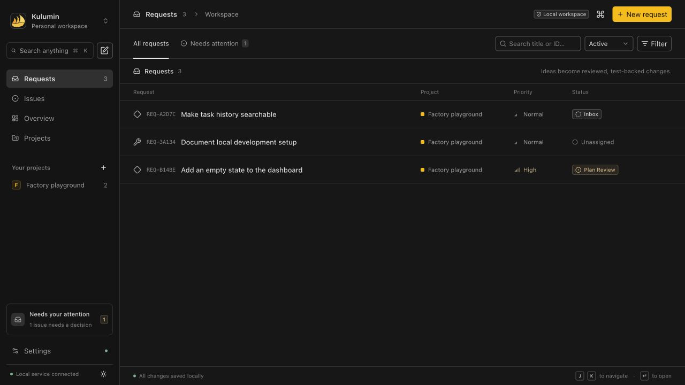

# Kulumin

A local, single-user software factory with deliberate human approval gates, built from [the product specification](software-factory-spec.md).

The app now supports **real Codex planning → exact plan approval → implementation in an isolated Git worktree → a local commit → configured validation → independent review → final human acceptance**. Progress, decisions, worktrees, checks, and recoverable failures persist in SQLite. A fake planner remains available for simulation and cannot authorize real execution.

Passing checks starts a fresh read-only reviewer. Test failures or actionable findings trigger up to three repairs, each followed by fresh checks and review. A passing independent review produces `FINAL_REVIEW`; only your decision can mark the exact reviewed commit `ACCEPTED`. Nothing is automatically merged, pushed, or deployed.

## Native app for daily use

The Apple Silicon macOS app bundles its Node runtime and SQLite addon. It runs without this source checkout, npm, or a separate Node installation. Git and Codex CLI (with your own sign-in) are still required for real tasks; checks need their own locally available dependencies.

Build and verify the local package:

```sh
npm run package:desktop
npm run test:package
```

Open `apps/desktop/src-tauri/target/release/bundle/macos/Kulumin.app`, or extract `release/Kulumin-0.1.0-macos-arm64.zip` and move the app to Applications. The ZIP has a SHA-256 sidecar and `release/release.json` with signing status. Runtime resources carry a separate verified manifest and licenses.

This machine has no Developer ID signing identity. The generated app is **locally ad-hoc signed and verified, not notarized**. Cross-machine distribution needs Developer ID signing and notarization. `APPLE_SIGNING_IDENTITY` selects an installed identity for local signing; the build never submits notarization automatically. Other CPU architectures/platforms are not claimed.

Release data lives at `~/Library/Application Support/local.kulumin.factory/`. Moving/replacing the app leaves that data intact. Release launches start empty, without demo repositories or enabled execution. Browser and development desktop databases are separate and are not silently moved. Use the backup workflow below if you want to move existing development data.

The native window uses private stdio IPC. Closing the window or quitting stops its service. Settings provides **Restart service** for a broken connection; interrupted work still needs explicit recovery. Finder launches search common local tool locations, including Homebrew and nvm, without running a login shell.

## Run from source

Requires Node **22.12+**, npm, and Git. Real workers require the locally installed Codex CLI and its existing sign-in (`codex login`). Native desktop development additionally needs Rust and the macOS Xcode command-line tools.

```sh
npm install
npm run dev
```

Open **http://127.0.0.1:1420**. The first launch creates a disposable sample repository, three requests, and two sample tasks. One task has a simulated proposal. Browser data lives in `.factory/browser/` and survives restarts.

```sh
npm run desktop
```

The desktop compiles and launches its Node companion over private stdio, with separate data in `.factory/desktop/`. Closing it drains workers and stops the companion; there is no background-running mode. This development shell needs the checkout and Node on PATH. Use the release package above for self-contained local use.

## Workspace interface

The desktop uses **Nuxt UI 4**, with a Linear-inspired neutral-gray layout, amber accents, and a persistent light appearance under **Settings → Appearance**. Requests open in an editor; issues open in a focused dialog with **Overview**, **Plan**, **Changes & checks**, **Review**, and **Activity** tabs. The properties rail keeps status and both human checkpoints visible.

Search lists by title or issue ID, filter by project/priority/provider, and switch Issues between list and board views. The Overview cards open matching issue filters. Request actions live in each row’s contextual menu.

- **Cmd/Ctrl-K** searches workspace actions, issues, and requests.
- **C** or **Cmd/Ctrl-N** opens a new request.
- **J / K** moves through the current list or board; **Enter** opens the focused item.
- **Esc** closes dialogs; **?** opens shortcut help.

Icons are bundled locally; the interface loads no remote fonts or icon services. Theme and reduced-motion preferences are respected without changing native CSP or approval requirements.



The amber ship uses three closely spaced swept sails and a low hull in three shades of amber. It is defined in `apps/desktop/public/kulumin-mark.svg`. Run `npm run icons` after editing it to regenerate the favicon/app SVG, PNG sizes, and macOS ICNS. Generated native icons are checked in; desktop packaging also regenerates them automatically to keep every surface in sync. See [the branding guide](docs/branding.md).

## Requests and revisions

**Requests** offers **Edit request** and **Archive request** in the row menu, plus an active/archived/all filter. **Save for later** keeps a request in the backlog without starting work. **Start task** saves it and immediately queues planning with the selected provider/model. Saved requests also offer **Start task with Codex** in the row menu; no separate task-creation step is required. If starting fails, the saved request stays available for retry. Archived requests can be restored; archiving never cancels or hides their tasks from Issues or Overview. All updates use optimistic version checks and create immutable history.

Existing tasks continue to use the request version captured when they were created, including the original project and acceptance criteria. Editing the request does not alter an approved plan or implementation. **Create revised request** copies the latest request into a new identity so updated scope can receive its own task and approval.

## Diagnostics, backup, and recovery

Under **Settings → Operations & recovery**, inspect integrity, free storage, active/interrupted workers, heartbeat notices, and runtime/schema versions. **Export support report** saves a report under the data folder's `exports/`, excluding private paths, text, source, diffs, logs, account details, and credentials. **Open data folder** reveals the local files.

**Create database backup** saves a consistent online SQLite snapshot and shows its hash. Unlike a support report, a database backup contains private request text, captured diffs, and logs. It does not copy repositories or worktrees. Preserve those directories separately if moving machines.

Restore is offline and never overwrites existing databases. Quit the destination app, choose a new data directory, then run:

```sh
npm run restore -- --backup /absolute/path/backup.db --data-dir /absolute/path/new-data-directory
```

Without the source checkout, use the bundled runtime and restore tool:

```sh
kulumin_resources="/Applications/Kulumin.app/Contents/Resources/companion"
"$kulumin_resources/runtime/node" "$kulumin_resources/dist/scripts/restore-backup.js" --backup /absolute/path/backup.db --data-dir /absolute/path/new-data-directory
open -n /Applications/Kulumin.app --env FACTORY_DATA_DIR=/absolute/path/new-data-directory
```

Restore checks database integrity/schema and retains the original worktree paths. Keep the original service closed while using a restored copy. If the backup contains task worktrees, also pass `--env FACTORY_WORKSPACE_ROOT=/absolute/path/original-managed-worktree-root` when launching: a new data directory otherwise selects a new workspace namespace. The original managed root is the task worktree path with its final project-ID/task-ID directories removed. Missing or mismatched worktrees are blocked for inspection, never recreated or reset. Starting the app reconciles unfinished work as interrupted; it never dispatches recovered jobs automatically. To inspect a renderer startup failure locally, opt into `FACTORY_NATIVE_DEBUG=1` when launching the app and capture stderr. Those raw diagnostics are separate from the shareable support report.

## Use implementation and validation

1. Register a repository in **Projects**. Its default branch must have an initial commit. Dirty files in the main checkout remain untouched and are not copied into a task’s worktree.
2. Connecting a repository opens **Finish project setup**. Existing projects have a **Project settings** button. Save it for planning only, set it up later, or explicitly trust the repository and enable implementation.
3. Configure **Worktree initialization** and **Verification** with named commands and timeouts. Settings reads and writes `.kulumin.yml` at the repository root. Commit this file on the default branch before starting a new task worktree. Use commands your repository actually supports.

   | Check | Example command | Purpose |
   |---|---|---|
   | Tests | `npm test` | Verify expected behavior |
   | Lint | `npm run lint` | Find style problems and common mistakes |
   | Build | `npm run build` | Check compilation/build output |

   Every configured check is required. Each runs after implementation and repairs in the isolated task worktree, and must succeed for the exact commit before independent review. Set the timeout long enough for your suite (for example, 180 seconds for a two-minute test run). Add separate checks instead of shell chains such as `npm test && npm run build`; quoted arguments are supported. The helper examples are suggestions, not automatic detection of repository scripts. Implementation requires at least one check in the setup form; planning requires none.
4. Create a request and choose **Save for later** or **Start task**. Start task immediately queues read-only planning; Codex uses your local CLI sign-in and the selected model/catalog default. Answer any clarification questions or request revisions before approval. Simulation remains explicitly labeled and cannot authorize execution.
5. Approve the exact plan revision/digest. If project execution is enabled, a worker starts automatically; otherwise the task remains queued until you explicitly start it. Existing queued tasks are not dispatched just because settings change. Simulated plans never start a real implementation.
6. Watch the task’s worktree, base/current commit, diff, progress, and validation logs. Successful checks for the exact current commit start independent read-only code review. Older tasks already at `CODE_REVIEW` offer **Revalidate & review**.
7. Inspect **Final human review**: implementation/repair summaries, limitations, diff, required checks and captured logs, independent findings and history, base/current SHA, and evidence digest. Choose **Accept reviewed commit**, **Request changes**, or **Reject**. Changes/rejection require feedback. Requests for changes stay within the approved plan and use the same three-repair budget; new scope needs a new request and approval.

Initialization runs in order before implementation in each new task worktree. Git does not copy ignored `node_modules` from your main checkout. For npm projects with a lockfile, configure `npm ci --include=dev` in initialization and request network access if downloads are needed. Each user must separately trust the repository, enable execution, and grant initialization network access locally; Git never transfers these permissions. Verification always stays offline.

```yaml
version: 1
worktree_init:
  network: true
  commands:
    - name: Install dependencies
      run: [npm, ci, --include=dev]
      timeout_seconds: 300
verification:
  commands:
    - name: Tests
      run: [npm, test]
      timeout_seconds: 300
    - name: Build
      run: [npm, run, build]
      timeout_seconds: 300
```

Commands are literal argument arrays, without implicit shell expansion. Invoke custom hooks as scripts, for example `[node, scripts/setup.mjs]`. Hooks may prepare ignored dependencies/artifacts; source or HEAD changes block the task and preserve those changes for inspection. Commands are bounded to 12 per section, with initialization timeouts up to 1,800 seconds and verification up to 300 seconds. The file is strict versioned YAML (no aliases, custom tags, duplicate keys, symlinks, or unknown settings).

Successful initialization is remembered per managed worktree and initialization configuration. Failures, cancellations and service restarts preserve setup logs, block progression and do not consume code-repair attempts. Recovery retries unfinished setup; **Initialize & revalidate** explicitly reruns successful setup before fresh verification and review. Existing tasks/projects without YAML retain their previous local verification configuration until migrated through settings. A file changed outside settings must be reviewed and saved locally before execution; uncommitted configuration cannot authorize a new worktree. Verification and final evidence bind to the committed YAML version.

Missing tools block for setup without consuming code-repair attempts. If a `tsx` CLI script needs a sandbox-blocked IPC socket, use `node --import tsx --test` instead; Kulumin’s own test script uses this entry point. Missing verification commands are disclosed as **NOT RUN** and block code review. Verification nonzero exits and timeouts trigger bounded repairs, while source/HEAD changes or changed configuration require inspection.

The implementer uses bounded list/read/write/delete tools confined to the task worktree. Shell, Git, network, plugins, and subagents are unavailable to the model. File edits require the digest from the latest read, and the service checks approval, task status, and run ownership before each operation. The service verifies and commits actual Git changes with hooks/signing disabled. Repositories with executable Git filters are currently blocked. Binary, symlink, protected metadata, and oversized file edits are unsupported.

Project code is sent to OpenAI through the signed-in Codex account. Snapshot/path exclusions and recognized credential redaction reduce exposure but do not guarantee arbitrary source is secret-free. Only use repositories suitable for that provider. Validation executes trusted project code under a no-network workspace sandbox and a restricted environment; worktrees are not disposable VMs.

## Cancellation and recovery

**Cancel task** and **Stop all workers** signal workers and terminate owned process groups as needed. The task’s branch, worktree, partial edits, commits, logs, and approval history remain. A stopping worker must terminate before recovery is available.

On restart, unfinished runs, initialization and checks become interrupted, never successful. Missing or changed worktree metadata is surfaced without resetting branches or recreating missing worktrees. A prior live process PID blocks recovery until inspected/stopped. The service owns an OS-backed exclusive SQLite lock in `service-owner.db`; a diagnostic `service.lock` also prevents overlap with older service versions. OS ownership releases on process crash.

For a stopped task, **Refresh changes**, inspect the current HEAD and diff, then choose **Resume implementation**, **Revalidate & review**, or **Initialize & revalidate**. Recovery binds to the displayed HEAD and worktree fingerprint; stale inspections are rejected. Implementation continues in the existing worktree using a fresh Codex session. Validation-only recovery requires a clean committed worktree and does not invoke an implementer; it runs fresh checks and independent review. Full provider-session resume is not promised.

The shared queue permits **two workers per factory service**, including planning/build/check/review/repair stages. Implementation defaults to a 15-minute model deadline, two attempts per approved plan, bounded file writes, and one-minute bounds on mutating Git operations. Check timeouts are per command. Project settings cannot change while that project has pending/active runs. Changing required checks invalidates prior passing evidence and acceptance. Worktree edits or later commits likewise revoke current acceptance on inspection/restart, preserving decision history. Final decisions always recheck the current HEAD and full evidence digest server-side.

## Data and service configuration

Database and artifact paths are local. Per-task worktrees default to `~/Library/Application Support/Kulumin/workspaces/` on macOS, under an instance/project/task namespace outside registered checkouts. Validation logs and scratch directories live under the selected data directory’s `artifacts/`. Worktrees are retained; post-acceptance cleanup remains an explicit future feature.

- `FACTORY_DATA_DIR`: alternate Node service/browser-development data directory.
- `FACTORY_WORKSPACE_ROOT`: alternate managed worktree root; it must be outside registered repositories and must match the root used when recovering existing tasks.
- `FACTORY_CODEX_BINARY`: select another installed Codex CLI executable.
- `CODEX_HOME`: forwarded explicitly when set; credentials remain Codex-managed.
- `FACTORY_DEMO=1`: seed sample fixtures in the standalone service only if no projects exist. Browser/desktop development seed empty data automatically.

```sh
npm run build:service
npm run service
```

The service accepts one JSON command per stdin line, e.g. `{"type":"snapshot"}`. Standalone data defaults to `.factory/desktop/`; do not use that directory concurrently with the desktop. Browser development binds only to loopback and rejects cross-origin commands with exact host/origin checks and a non-simple header. Desktop transport has no HTTP endpoint.

## Verification

```sh
npm run typecheck
npm test
npm run build
cargo check --manifest-path apps/desktop/src-tauri/Cargo.toml --locked --offline
```

Default tests use disposable repositories and protocol fixture subprocesses, **without model calls**. They cover approvals, concurrency, worktree isolation, local commits, validation truth/staleness, read-only review, bounded repairs, exact-commit final decisions, cancellation, process ownership, restart recovery, path protection, and credential-safe output streaming.

Opt-in real-provider checks use the existing Codex sign-in and disposable sample source:

```sh
npm run test:codex
npm run test:codex -- --probe-only
npm run test:implementation
npm run test:initialization
```

The implementation smoke test makes real planning, implementation, independent review, and human-requested repair turns, approves/accepts only its disposable fixture, verifies fresh commits/checks/reviews and exact final acceptance, preserves the main checkout, probes workspace-write/network restrictions, and checks validation process-tree cancellation. Tested with **Codex CLI 0.153.4**. A model catalog is not an entitlement guarantee; access is verified by successful inference. Models are selected before a run and never silently changed mid-run.

See [implementation status](docs/implementation-status.md), [verification record](docs/verification.md), [review/acceptance ADR](docs/architecture-decisions/0005-review-repair-and-final-acceptance.md), [daily-use desktop ADR](docs/architecture-decisions/0006-daily-use-desktop-and-request-history.md), and [worktree/execution ADR](docs/architecture-decisions/0004-approved-worktree-execution.md). Richer provider/auto-assignment policy, optional notifications/PR integration, notarized distribution, and explicit worktree cleanup remain future work. Claude stays disabled.

`npm run test:initialization` verifies real app-server sandboxed dependency setup (`npm ci`) and offline verification (`npm test`) in a disposable Git worktree using a local fixture dependency. It makes no model calls or registry downloads.
